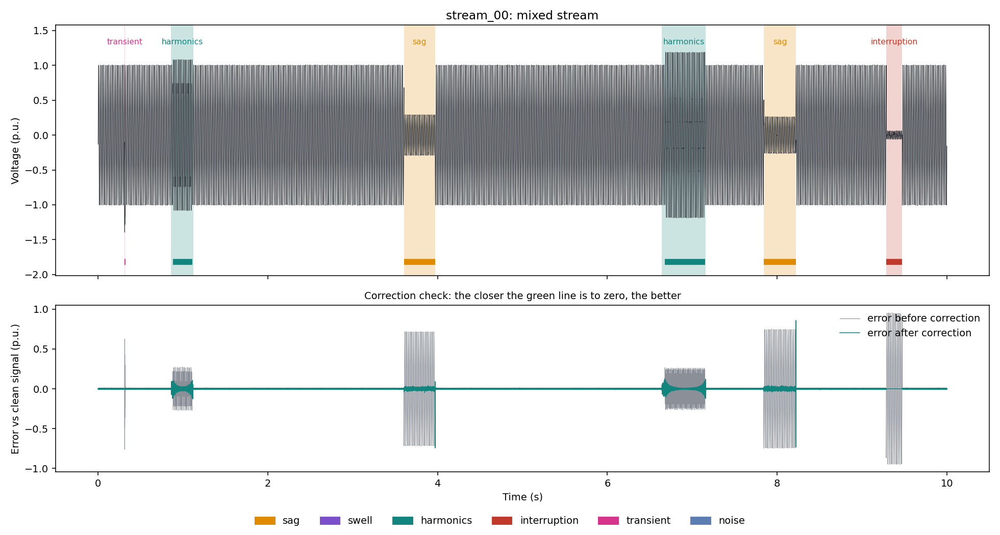

# AI Power Quality Analyzer

1-D CNN that detects power quality disturbances in a continuous voltage signal, reports them with IEEE 1159 categories, and corrects the signal.

A long voltage signal goes in. The system finds each disturbance, names it, measures it, writes a report, repairs the signal, and then checks the repair against the clean signal.



*Top: the signal with detected events shaded and true events as bars. Bottom: the error against the clean signal, before and after correction.*

## What it does

1. **Generates data.** Creates a long synthetic voltage signal (50 Hz, 10 kHz sampling) with disturbances placed at random times. It keeps the clean signal and the true event list as an answer key.
2. **Detects and names.** A sliding window (a small box that moves along the signal) feeds a 1-D CNN (a neural network that slides small filters along a signal to find patterns). The CNN labels every window as one of 7 classes.
3. **Finds events.** Neighbouring windows with the same label are joined into events with a start time, an end time and a duration.
4. **Reports.** Exact formulas measure each event: RMS in p.u. (per-unit, voltage as a fraction of nominal, so 0.7 means 70%), sag depth, duration, THD (Total Harmonic Distortion, how much extra frequency content is mixed in), noise level. Rules map the values to IEEE 1159 categories.
5. **Corrects.** A different fix is used for each class (table below).
6. **Verifies.** Compares the corrected signal with the clean one, and runs the CNN again on the corrected signal.

The CNN decides **what** the disturbance is. Formulas measure **how much**. Rules say **which standard category**. For sag, swell and interruption, the measured RMS has the final say, which fixes the usual sag-versus-interruption mix-up.

## Classes and corrections

| Class | What happens to the waveform | Correction |
|---|---|---|
| Normal | Clean sine wave | none |
| Sag | Amplitude drops for a short time | Gain correction (nominal ÷ measured RMS) |
| Swell | Amplitude rises for a short time | Gain correction |
| Harmonics | 3rd, 5th and 7th harmonics added | Notch filters (each removes one exact frequency) |
| Interruption | Voltage falls below 0.1 p.u. | Sine rebuilt from nearby clean cycles (an estimate) |
| Transient | Short, fast, fading burst | Burst replaced by a fitted sine |
| Noise | Random fuzz on the wave | Wavelet denoising (removes small high-frequency wavelet parts) |

## Quick start

```bash
git clone https://github.com/devsharmacodes/ai-power-quality-analyzer.git
cd ai-power-quality-analyzer
pip install -r requirements.txt
pip install -e .
```

Generate the dataset and train the CNN:

```bash
python -m pqd.generation.make_dataset --per-class 2000
python -m pqd.models.train --epochs 30
```

Test the whole pipeline on long continuous streams:

```bash
python scripts/evaluate_streams.py --fresh 10
```

Start the dashboard:

```bash
streamlit run app/dashboard.py
```

The dashboard lets you pick the signal source (random mixed stream by default, or one class at a time), then shows the events, the report table, the before and after correction, and how sure the CNN is for each window.

## Results

**Window classification** (200 ms windows, 14,700 generated windows split 70/15/15 per class, test set used once):

| | Result |
|---|---|
| Test windows | 2,100 (300 per class) |
| Accuracy | about 100% (1 window wrong out of 2,100) |

**Continuous streams** (generated streams the CNN has never seen):

| Measure | Result |
|---|---|
| Events found | [fill from `reports/stream_eval/summary.json`] |
| Labels correct | [fill] |
| False alarms | [fill] |
| Error vs clean signal, before → after correction | [fill] p.u. |

> **Read the accuracy honestly.** The test windows come from the same generator as the training windows, and the classes barely overlap, so a near-perfect score is expected. It does not prove the same performance on real measured signals.

## How the CNN works

- **Input:** one window of 2,000 voltage samples (200 ms at 10 kHz, 10 cycles at 50 Hz).
- **Body:** four convolution blocks with batch normalisation. It uses both global average pooling (keeps the overall shape) and global max pooling (keeps short bursts such as transients).
- **Output:** 7 class probabilities. The model is small, about 37,000 parameters.
- **Training:** AdamW optimizer, cosine learning-rate schedule, best epoch chosen by validation accuracy.

## Project structure

```
src/pqd/
├── config.py          settings loaded from config.yaml
├── generation/        disturbance models, long streams, dataset maker
├── processing/        sliding window, sine fitting
├── models/            1-D CNN, training, prediction
├── events/            joins window labels into events with start and end
├── report/            exact formulas, IEEE 1159 rules, report builder
├── correction/        gain, notch, wavelet, sine rebuild, router
├── evaluation/        accuracy, event matching, correction check, plots
└── pipeline.py        one analyze() call that runs everything
app/dashboard.py       Streamlit dashboard
scripts/               stream evaluation script
config.yaml            50 Hz, 230 V, 10 kHz, window length, seed
```

Settings such as the sampling rate, window length and random seed are all in `config.yaml`. The same seed always gives the same signal.

## Limitations

- **Synthetic data only.** All signals are generated by code. Real recordings from a power line are future work.
- **Single-phase voltage only.** Three-phase and current signals are not handled.
- **Fixed signal settings.** The CNN is trained for 50 Hz at 10 kHz sampling. Other settings need new data and retraining.
- **One disturbance at a time.** Overlapping events, such as a sag with harmonics, are not handled yet.
- **Interruption correction is an estimate.** When the voltage is almost zero, the real information is gone, so the sine is rebuilt from the cycles before the event. Real systems use a UPS (battery backup).
- **Event edges differ by class.** Sag, swell and interruption edges are sharp. Harmonics and noise edges are less exact.
- **IEEE 1159 limits were written from memory.** Check `src/pqd/report/ieee1159.py` against your own copy of the standard before quoting them.

## Future scope

- Real measured PQD datasets and hardware validation
- Three-phase signals
- Several disturbances at the same time (multi-label classification)
- Unknown-event detection, so the system can say "none of my classes" instead of guessing
- Explanations for each prediction (which part of the window drove the answer)

## About

Minor project, Department of Electrical Engineering, Gurukul Kangri (Deemed to be University), Haridwar. Academic session 2026-27.
